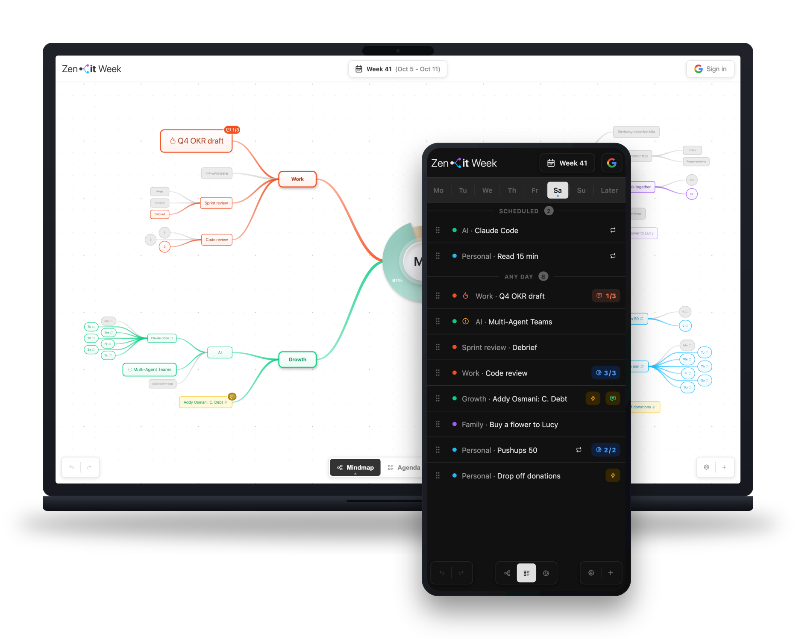

# Zenit Week

> Plan your week around what matters most - not what's just urgent.
> A visual mind-map planner that runs in your browser. No signup. No servers holding your data. Free.



[**Try it now →**](https://zenitweek.com/) · [Privacy](https://zenitweek.com/privacy) · [Available in English & Čeština](https://zenitweek.com/cs/)

---

## Why?

Most planners are flat lists. Zenit Week is a tree. You see your whole week - work, family, yourself - in one view, balance and all.

The "rocks first" idea: fill the jar with sand first and the big rocks won't fit. Reverse it and they do. Most weeks fail the same way - emails and small tasks fill the jar before the things that actually matter get a place. Zenit Week makes the rocks the easiest thing to see.

## Quick start

- **Online:** open [zenitweek.com](https://zenitweek.com/) and start in seconds.
- **Offline:** download `zenit-week.html` and open it in any modern browser. Your data is saved to the browser's IndexedDB. Optionally sign in with Google to sync to your own Drive.

No account is required. No cookies, only anonymous visit counts. Your data never touches Zenit Week's infrastructure.

## Features

- **Mind-map view** with a center node and radial branches. Defaults are Work, Family, Me - but every branch is yours to rename, recolor, add, or remove.
- **Three views, one week:** *Mindmap* for the whole-week picture, *Agenda* for day-by-day execution with Mon–Sun tabs and an Overdue lane, *Stats* for balance, trend and completion.
- **Week navigation** - a week bar with prev/next arrows, the week's date range, and a click on the label to jump back to the current week.
- **View levels - Rocks, Pebbles, Sand:** zoom out to just the big rocks, fade out deep detail with pebbles, or reveal everything with sand.
- **Priorities (Normal / High / Critical):** scale layout space and visual weight; cascade to children automatically.
- **Counters** - type `Nx` in any task name to track progress (e.g. *Pushups 10x*); click to increment, every tick is timestamped.
- **Day indicators** - append `(mo, we, fr)` to a task to schedule it for those days (Czech tokens `po, út, st, čt, pá, so, ne` also work). Ranges work too - `(mo-we)`. `daily` schedules all seven days and auto-adds a 7-counter, `(today)` / `(tomorrow)` freeze to the real weekday on save, and `(now)` also pins the task to the top of today's agenda.
- **Comments** - attach a note to any activity; a badge on the node and in the agenda opens it.
- **Reusable tasks** - flag tasks that repeat every week; *Transfer Reusable* copies them forward with counters reset. *Disposable* clears the flag again.
- **Transfer Unfinished** - carry incomplete work into the next ISO week with one action. *Move to next week* relocates a single task and its subtree.
- **Effort baseline** - set a realistic activity-per-week target; the summary turns yellow at stretch, red at overload.
- **Quick-add** - floating input to drop a task straight onto any branch without touching the mind map.
- **Auto-layout** - automatic radial positioning after each change, toggleable in settings.
- **Drag to rebind / reorder** - drag a node onto another to re-parent it, or between siblings to reorder.
- **Daily log** - completed and ticked activities collected with timestamps and branch dots.
- **Light & dark theme** - respects `prefers-color-scheme` on first load.
- **Languages** - English and Čeština, with browser-language detection and a dismissable suggestion banner.
- **Optional Google Drive sync** - your own Drive, scope `drive.appdata` only, one file per week, never our servers. Conflict resolution by last-write-wins with CRDT tombstones, auto-polled every 10s.
- **Undo / Redo** - 100 levels.
- **Works offline** - installable as an app; the shell is cached by a service worker and edits made offline are uploaded once you are back online.
- **Export & import** - full backup as JSON.
- **Touch-friendly** - pinch to zoom, swipe an agenda item right to mark done, left for options.

## Keyboard shortcuts

### Views and navigation

| Action | Shortcut |
| :--- | :--- |
| Switch to Mindmap / Agenda / Stats | `M` / `A` / `S` |
| Help & hotkeys | `?` or `H` |
| Quick add (inbox item) | `Q` |
| Previous / next week | `[` / `]`, or `Shift + ←` / `Shift + →` |
| Jump to the current week | `T` |
| Fit everything to the view (mindmap) | `F` |
| Cycle view level - Sand · Pebbles · Rocks | `V` |
| Filter mindmap by day | `1`–`7` on empty canvas |
| Filter to Unscheduled / Overdue | `8` / `0` on empty canvas |
| Undo | `Ctrl/⌘ + Z` |
| Redo | `Ctrl/⌘ + Shift + Z` or `Ctrl/⌘ + Y` |
| Close panel / dialog (in the agenda on desktop: back to the mindmap) | `Esc` |

### Mindmap - on the hovered or focused node

Arrow keys move a focus ring from node to node, so every shortcut below works without a mouse.

| Action | Shortcut |
| :--- | :--- |
| Move the focus ring | `↑` `↓` `←` `→` |
| Rename | `Enter` |
| Add child | `Tab` |
| Delete | `Backspace` / `Delete` |
| Toggle done | `D` |
| Toggle unplanned | `U` |
| Cycle priority - Normal · High · Critical | `P` |
| Comment | `C` |
| Toggle reusable | `R` |
| Move to next week | `N` |
| Toggle day | `1`–`7` (Mon–Sun) |
| Clear all day indicators | `8` |
| Clear the whole week (on the root node) | `Backspace` / `Delete` |
| Quick options menu | Right click |

### Agenda

| Action | Shortcut |
| :--- | :--- |
| Move between items | `↑` / `↓` |
| Previous / next day tab | `←` / `→` |
| Jump to a day / Overdue | `1`–`7` / `0` |
| Toggle done | `D` |
| Rename | `Enter` |
| Delete | `Backspace` / `Delete` |

Drag the background to pan. Scroll or pinch to zoom. Click the logo to fit everything to the view.

## AI agents (desktop)

Let an AI agent on your computer - Claude Code, Claude Desktop or any MCP client - plan your week with you. Ask it to add tasks, set days or carry over what you didn't finish, and it does it in the app as if you clicked.

- Every change shows a toast and is one undo step.
- Your phone follows through Drive sync.
- It is off by default and talks only to `127.0.0.1`, never to us.
- Works in desktop Chrome and Firefox. Safari is not supported yet.

### Set it up

**Claude Desktop:** download [zenit-week.mcpb](https://github.com/kruxik/zenit-week/releases/latest/download/zenit-week.mcpb), open it and confirm in Claude Desktop - no terminal, no Node.js. Then continue with step 2.

Other agent apps need [Node.js](https://nodejs.org/) 20 or newer.

1. Register the server with your agent. For Claude Code:
   ```sh
   claude mcp add --scope user zenit-week -- npx -y zenit-week-mcp@1
   ```
   For another MCP client, add a stdio server with the command `npx` and the arguments `-y zenit-week-mcp@1`. The [server README](mcp/README.md) has the Claude Desktop config.
2. Open [zenitweek.com/app](https://zenitweek.com/app), go to **Settings > AI agents** and turn on **AI agents**. Your browser then asks to let Zenit Week reach apps on this computer: choose **Allow**. In Firefox, also tick **Remember my choice**.
3. Ask your agent something about your week. Zenit Week shows a 6-digit code and your agent shows the same one. Check that they match and click **Allow**.
4. Settings shows **Connected**. From now on requests run at once, also after a restart.

### Managing the connection

- **Unpair:** **Unpair** in Settings, signing out or resetting the app removes the pairing. From the terminal: `npx -y zenit-week-mcp@1 unpair zenitweek.com`.
- **Several agent apps:** each runs its own server and the app connects to all of them. Pairing once covers them all.
- **Open the app automatically:** add `--open` after `zenit-week-mcp@1` in the server command and it opens the site you used last when no tab is connected.
- **Dev tunnel (ngrok):** run `npx -y zenit-week-mcp@1 origins add https://<your-tunnel-host>` once. The agent can then work with production and the tunnel side by side; see the [server README](mcp/README.md).

### For developers: run it from the repository

To work on the server itself, run it from a clone of this repository instead of npm:

1. Install the server:
   ```sh
   cd mcp && npm install
   ```
2. Register it with your agent. For Claude Code:
   ```sh
   claude mcp add --scope user zenit-week -- node "$PWD/server.js"
   ```
   For another MCP client, the command is `node /path/to/zenit-week/mcp/server.js`.
3. Continue with step 2 above.

The server ships with the app: `npm run release` raises its minor version when anything in it changed since the last release, and the production deploy publishes it to npm (trusted publishing, no stored token) and attaches the Claude Desktop extension, built by `npm run mcp:bundle`, to the release. The package keeps its own version number; app and server agree through a protocol number.

## Privacy

Zenit Week runs no servers that hold your data. Your data lives in your browser, or - if you opt in - in your own Google Drive's hidden app folder. We never see it. The only data that briefly touches our infrastructure is your IP address while the page loads, handled by our hosting provider Vercel, plus cookieless, aggregated usage counts from Vercel Web Analytics and Umami (no personal identifiers, never your task content). Signing in with Google goes through one small serverless function of ours that exchanges OAuth tokens; it never sees your plans. A second one passes Umami's usage counts on to Umami together with your IP address, so Umami can look up the country, and stores nothing.

Full details in the [privacy policy](https://zenitweek.com/privacy).

## Who's behind it

I'm [Petr Burian](https://www.petrburian.com/). For 16 years I was the CTO behind Flashscore, which our teams built for 130 million sports fans. Today I mentor founders, CEOs and CTOs.

Near the end of my sabbatical, I worried I wasn't working enough. Then I drew my week as a mind map and it floored me: the Work branch was 10x bigger than anything else. Since then, I plan my week around what matters to me.

[petrburian.com](https://www.petrburian.com/) · [LinkedIn](https://www.linkedin.com/in/burian-petr) · [GitHub](https://github.com/kruxik)

## Contributing

Architecture, development setup, and guidelines for pull requests are in [CONTRIBUTING.md](CONTRIBUTING.md).

## Sponsoring

If Zenit Week saves you time and headspace, you can support the project. *(Ko-fi link will appear here once the account is set up.)* Starring the repo also helps.

## License

MIT - see [LICENSE](LICENSE).

Zenit Week ships two third-party libraries, both MIT-licensed:

- [Tabler Icons](https://tabler.io/icons) - UI icons
- [ProseMirror](https://prosemirror.net) - the rich comment editor

Full copyright and licence texts are in [THIRD_PARTY_NOTICES.md](THIRD_PARTY_NOTICES.md).
